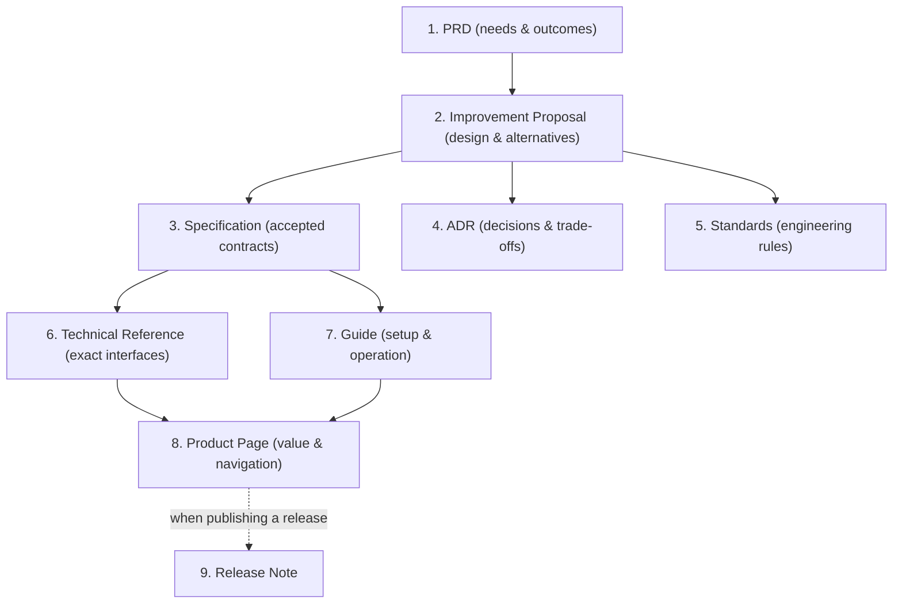

# Gyrus Context Control Plane & Documentation Directives

Always-on governance rules for discovering, querying, and authoring OKF (Open Knowledge Format) concepts through the Gyrus Context Control Plane.

## Core Principles

1. **Source Code vs. Gyrus**: Source code owns implementation logic and routine diffs; Gyrus owns architectural intent, system contracts, rationale, and operational workflows. Never mirror code diffs into Gyrus.
2. **Resolve Context First**: Before designing, debugging, or changing architecture or contracts, discover existing context via MCP (`gyrus_suggest_context`, `gyrus_search`, `gyrus_neighbors`, `gyrus_traverse`; fall back to the `gyrus` CLI only if MCP is unavailable).
3. **Update in the Same Change**: Any code change invalidating a contract, command example, or runbook must update its owning Gyrus concept in the same change.
4. **One Clear Owner**: Preserve useful rationale and examples in the owning concept; link related concepts rather than duplicating contracts or reducing docs to link-only stubs. Label planned work clearly so proposals cannot be mistaken for implemented behavior.
5. **Right-Sized Docs**: Not every change needs every document type. Update the existing contract owner; create a proposal or ADR only when recording a material design choice.

## Document Dependency Graph (Internal Development Flow)

- **Progression**: PRDs define the problem and success criteria; Improvement Proposals explore alternatives and risks before implementation settles; Specifications, ADRs, and Standards distill accepted contracts, individual tradeoffs, and reusable rules from the proposal; Technical References and Guides operationalize the spec; Product pages introduce value and link readers forward.
- **Release Notes**: Only create for verified publication milestones—routine fixes and doc updates do not require one.

## Document Types, Mutability & Scope

| Type | Lifecycle | Typical Scope | Owns |
| :--- | :--- | :--- | :--- |
| `prd` | Living | Project | User problem, outcomes, constraints, success criteria |
| `improvement-proposal` | Historical (immutable once finalized) | Project | Design alternatives, risks, acceptance criteria |
| `specification` | Living | Project / Reference | Accepted system contracts, data rules, boundaries |
| `adr` | Historical (immutable once `accepted`) | Project / Reference | One decision, rationale, alternatives, consequences |
| `standards` | Living | Reference / Project | Repeatable engineering and documentation rules |
| `technical-reference` | Living | Project | Exact CLI, MCP, API, and configuration schemas |
| `guide` | Living | Project | Complete install, operation, validation, or troubleshooting flows |
| `product` | Living | Project | Product value and navigation to supporting docs |
| `glossary` | Living | Reference / Project | Shared domain definitions and terminology |
| `release-note` | Historical (immutable once published) | Project | Verified release changes and upgrade impact |
| `freeform` | Living | Project / Reference | Working notes not yet fitting a structured type |

### Scoping on Reads vs. Writes

| Operation | Scope Strategy | Rationale |
| :--- | :--- | :--- |
| **Reading / Discovering** | Default to `scope: "all"` (or query both `project` and `reference`); narrow to `scope: "project"` + `project` to reduce noise, or `scope: "reference"` for shared standards only | Repo specs and PRDs live in `projects/<project>`, while cross-project standards, glossaries, and shared ADRs live in `reference` |
| **Writing / Creating** | Set scope explicitly: `scope: "project"` + `project` (`<tenant>/projects/<project>/<id>`) for repo-specific docs; `scope: "reference"` (`<tenant>/reference/<id>`) *only* for shared cross-project standards, decisions, or glossaries | Prevents repo-specific docs from polluting shared `reference` scope |

## Identity, Links & Immutability

- **Frontmatter**: Required fields are `id`, `title`, `category`, `type`, `tenant`, `version`, `status`. Local `id` must match `^[a-z0-9-_]+$` and the filename without `.md`. Omit derived `name`, `scope`, and `project` from YAML.
- **Qualified names**: Existing-concept reads, updates, and links require `<tenant>/reference/<id>` or `<tenant>/projects/<project>/<id>` (no short-ID fallback).
- **Typed links**: Persist source-owned links only as `{concept: <qualified-name>, rel: <relation>}` using `depends_on`, `implements`, `supersedes`, or `mitigates`. Never store inverse copies (incoming queries derive backlinks).
- **Superseding immutable records**: Never rewrite finalized ADR/proposal bodies. Create a replacement ADR → link it with `supersedes` → set the old record's status to `superseded`.
- **Body links**: Use repository-relative links, never machine-specific `file://` URLs.

Load the `gyrus` skill for discovery/querying workflows, MCP tool usage, User Discovery flow, ADR authoring sections, and Git initiative branching.
