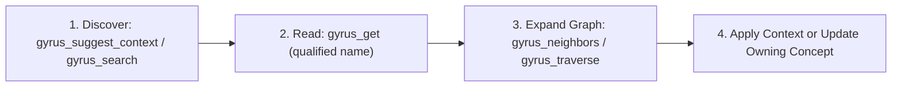

# Gyrus Agent Skill: Context Discovery & Operations

Operational guide for **discovering, querying, traversing, and authoring** architectural context in Gyrus via MCP. Always-on governance rules, the **Internal Development Flow** dependency graph, Read/Write scoping defaults, and the 11-type mutability table live in `rules/AGENTS.md`.

## Context Discovery & Querying Workflow

1. **Discover Broadly First**:
   - Use `gyrus_suggest_context(prompt, scope)` for task-oriented lookup.
   - Use `gyrus_search` for targeted keyword queries or structured metadata filtering (`type`, `category`, `status`, `tag`, `scope`, `project`, `tenant`). Pass an empty `query` for unlimited metadata browsing; keyword search defaults to 10 results (`max_results` overrides).
   - **Read Scoping**: Default to `scope: "all"` so cross-project `standards`, `glossary`, and shared `adr` concepts in `reference` aren't missed alongside repo-specific docs in `projects/<project>`. Narrow to `scope: "project"` + `project` when filtering noise, or `scope: "reference"` when checking shared standards only.
2. **Fetch Exact Concepts**: Call `gyrus_get` with the full qualified name (`<tenant>/reference/<id>` or `<tenant>/projects/<project>/<id>`).
3. **Traverse Dependencies & Backlinks**:
   - Call `gyrus_neighbors(id, direction: "both" | "incoming" | "outgoing", rel_type)` to see what a concept `depends_on` / `implements` / `supersedes` / `mitigates` and what links *into* it (backlinks are derived automatically).
   - Call `gyrus_traverse(start_id, max_depth)` to inspect multi-hop architectural dependencies and blast radius before changing contracts.

## Authoring & Maintenance Workflow

1. **Resolve First**: Run the discovery workflow above to find owning PRDs, specs, ADRs, and standards before editing behavior or creating new concepts.
2. **Scope Writes Explicitly**: Use `scope: "project"` + `project` for repo-specific docs; use `scope: "reference"` *only* for shared cross-project standards, decisions, or glossaries.
3. **Preserve Owning Contracts**: Update the owning concept via `gyrus_update` (pass `expected_version` to prevent stale overwrites) with full explanations and examples—avoid link-only stubs that strip rationale. Check `gyrus_schema_get(type)` when you need a contract template.
4. **Ground Against Schemas**: Match examples to actual CLI, MCP, and config behavior, including failure modes and known limitations.
5. **ADR Structure**: Every `adr` must include: *Context / Problem / Objectives*, *Decision & Rationale*, *Alternatives (Pros / Cons)*, *Consequences*, and *Compliance & Verification*.
6. **Verify Before Finishing**: Confirm scope, YAML metadata, qualified links, and repository-relative body links; report verified vs. skipped checks explicitly.

## User Discovery & Consumption Flow

Structure user-facing concepts so each layer links cleanly to the next level of detail:

- Start readers with value and navigation (`product` / `README.md`), guide them through complete workflows (`guide`), answer exact syntax questions (`technical-reference`), and link deeper contracts and tradeoffs (`specification`, `adr`).

## MCP Tool Overview

| Category | Tools | Purpose |
| :--- | :--- | :--- |
| **Discovery & Graph** | `gyrus_suggest_context`, `gyrus_search`, `gyrus_get`, `gyrus_neighbors`, `gyrus_traverse` | Find concepts by prompt or metadata, read by qualified name, and inspect incoming/outgoing or multi-hop relationships |
| **Authoring & Links** | `gyrus_create`, `gyrus_update`, `gyrus_link`, `gyrus_unlink`, `gyrus_archive` | Create concepts (local `id` + explicit scope), update with `expected_version`, manage typed edges, or archive obsolete concepts |
| **Schemas** | `gyrus_schema_list`, `gyrus_schema_get`, `gyrus_schema_set`, `gyrus_schema_delete` | Inspect or manage OKF concept templates by type |
| **Git Sessions** | `gyrus_git_status`, `gyrus_git_switch` | Check active branch state or switch between `direct` (trunk) and `branching` (initiative branch) modes |

> **CLI Fallback**: MCP is the primary interface. Only fall back to the `gyrus` CLI (`gyrus --help`) if MCP is unavailable, or to validate manually edited local OKF files with `gyrus validate <filepath> --json`.

## Qualified Identity, Links & Supported Stacks

- **Create vs. Existing Ops**: `gyrus_create` takes a local frontmatter `id` plus `tenant`/`scope`/`project`. All reads, updates, links, and traversals require a full qualified name (`root/reference/adr-example` or `root/projects/gyrus/spec-001-contract-schema`) with no short-ID fallback.
- **Links**: Persist only `{concept: <qualified-name>, rel: <relationship>}` (`depends_on`, `implements`, `supersedes`, `mitigates`). Never store inverse copies; typed links and required Gyrus metadata extend upstream OKF.
- **Stacks**: `localfs`/OKF, `git`/OKF, or `postgres` (with PostgreSQL index/graph and native FTS). SQLite index/graph/search providers and `sync` are removed—OKF reads files directly. Unknown config keys and malformed files fail strictly without fallback.
- **Git Initiative Sessions**: Config holds `repo_url`, `trunk_branch` (default `main`), and `commit_strategy: direct | branching` (default `direct`). Select an initiative branch at runtime via `gyrus_git_switch({strategy: "branching", branch: "initiative/name"})` and return to trunk with `{strategy: "direct"}`. Each MCP process owns its selection (re-select after restart), and a `branching` server rejects knowledge ops until a branch is selected. Gyrus never creates PRs, merges, rebases, or force-pushes—humans merge initiative branches in the Git host.

## Reference

- **[OKF Schemas Reference](references/okf-schemas.md)**: Full frontmatter fields, allowed categories/types, and status transition matrix.
